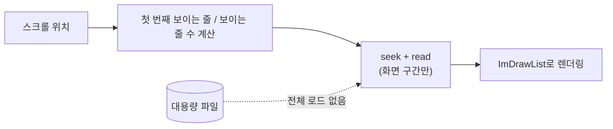
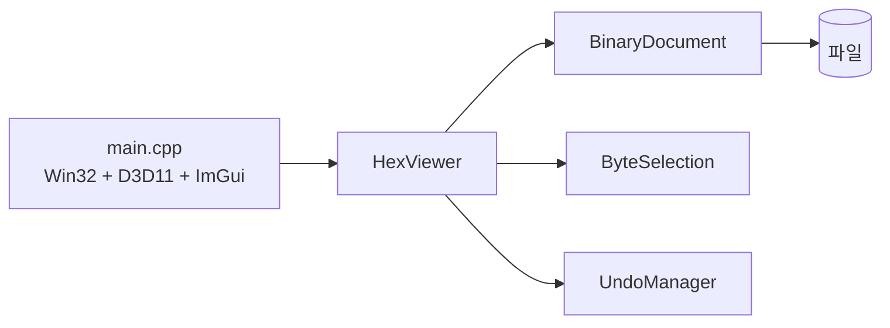

# DuckHex

C++20 · Win32 · Direct3D 11 · Dear ImGui 로 만든 **Windows 바이너리(Hex) 편집기**입니다.
대용량 파일도 화면에 보이는 구간만 읽어 표시하고, 바이트 선택·패턴 검색·덮어쓰기 편집·Undo/Redo를 지원합니다.


---

## 특징: 파일 전체를 메모리에 올리지 않습니다

많은 간단한 Hex 편집기는 파일을 통째로 메모리에 읽어 들입니다. DuckHex는 **스크롤 위치에 해당하는, 지금 화면에 보이는 구간만 실시간으로 파일에서 읽어** 표시합니다.

- 메모리 사용량이 **파일 크기가 아니라 화면 크기**에 비례합니다. 수백 MB~GB 파일도 열자마자 표시됩니다.
- 스크롤할 때마다 현재 화면에 필요한 `(보이는 줄 수 × 줄당 16바이트)`만 `seek` 후 읽습니다.
- 전체 파일 크기만큼의 스크롤 영역은 별도로 계산해 확보하므로, 데이터를 로드하지 않아도 스크롤바와 위치가 정확합니다.
- 편집한 내용도 해당 오프셋에만 직접 기록합니다.




---

## 만든 이유

- 바이너리 파일의 구조와 메모리/파일 I/O를 직접 다뤄 보고 싶었습니다.
- 기존 GUI 프레임워크 대신 **Win32 + Direct3D 11 + Immediate Mode GUI(Dear ImGui)** 로 렌더링 루프부터 직접 구성하며 Windows 네이티브 개발 역량을 키우는 것이 목표였습니다.

## 주요 기능

| 기능 | 설명 |
| --- | --- |
| 파일 열기 | Win32 파일 대화상자(`GetOpenFileNameW`)로 임의의 파일 열기 |
| Hex 뷰어 | 주소 / 16바이트 Hex / ASCII 형태로 표시, 8바이트 단위 그룹 구분 |
| **구간 단위 실시간 읽기** | 파일 전체를 메모리에 올리지 않고, 스크롤 위치의 **화면에 보이는 구간만** 그때그때 읽어 표시 |
| 바이트 선택 | 마우스 클릭 · 드래그로 단일/범위 선택, 선택 영역 하이라이트 |
| 바이트 편집 | 선택 영역을 더블클릭하거나 `Edit` 버튼으로 Hex 값 입력 후 덮어쓰기 (길이·형식 검증) |
| 패턴 검색 | Hex 바이트 패턴 검색, 결과 개수 표시, `Previous` / `Next` 이동 및 자동 스크롤 |
| Undo / Redo | 편집 이력 관리, `Ctrl+Z` / `Ctrl+Shift+Z` |
| 도킹 UI | ImGui Docking 기반 패널 레이아웃(Menu / Hex Viewer / Search 등) |


### 단축키

| 키 | 동작 |
| --- | --- |
| `Ctrl + F` | 검색 패널 포커스 |
| `Enter` | 선택 영역 편집 팝업 열기 / 검색·편집 입력 확정 |
| `Ctrl + Z` | Undo |
| `Ctrl + Shift + Z` | Redo |
| `Esc` | 편집 팝업 닫기 |

## 사용 기술

| 분류 | 내용 |
| --- | --- |
| 언어 | C++20 |
| 플랫폼 / API | Win32 API (윈도우 생성, 메시지 루프, 파일 대화상자) |
| 그래픽 | Direct3D 11, DXGI (Swap Chain, Render Target View) |
| GUI | Dear ImGui 1.92.9 (Docking, Win32 / DX11 백엔드) |
| 표준 라이브러리 | `std::fstream`, `std::filesystem`, `std::optional`, `std::vector` |
| 빌드 | Visual Studio 2026 (v145 툴셋), x64 |

## 구조

문서(데이터) · 뷰(표시/입력) · 선택 · 이력 관리를 클래스로 분리했습니다.

```text
DuckHex
├─ main.cpp            Win32 윈도우 / D3D11 초기화, 메시지 루프, 도킹 레이아웃, 메뉴
├─ BinaryDocument      파일 I/O (구간 읽기, 덮어쓰기, 바이트 패턴 검색)
├─ HexViewer           Hex 렌더링, 마우스·키보드 입력, 편집·검색 UI
├─ ByteSelection       선택 범위(Begin / End / Length / Contains) 관리
├─ UndoManager         Undo / Redo 스택 (offset, 이전 데이터, 새 데이터 저장)
└─ Imgui/              Dear ImGui (외부 라이브러리)
```


